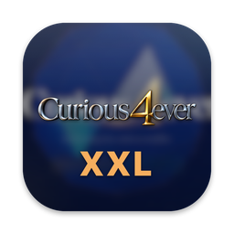
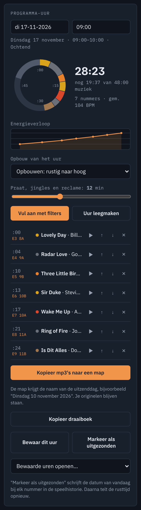
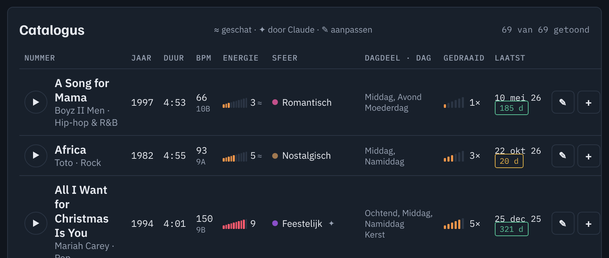
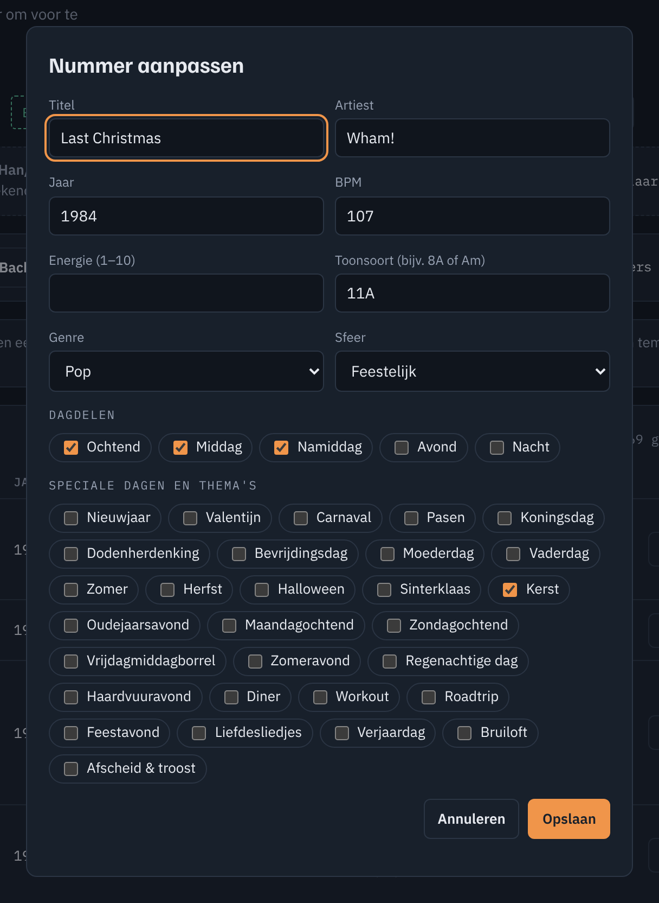

<p align="center">
  
</p>

<h1 align="center">CURIOUS XXL</h1>

<p align="center">
  <b>Het zendpult voor je eigen muziek.</b><br>
  Stel uit je hele mp3-bibliotheek in een paar minuten een radio-uur samen dat tot op de seconde klopt.
</p>

<p align="center">
  <a href="https://github.com/an0n1mu3721-spec/curious-xxl/releases/latest"></a>
  
  
  
</p>

<p align="center">
  <a href="https://github.com/an0n1mu3721-spec/curious-xxl/releases/latest"><b>Download</b></a> ·
  <a href="docs/CURIOUS%20XXL%20-%20Handleiding.pdf"><b>Handleiding (PDF)</b></a> ·
  <a href="CHANGELOG.md"><b>Wijzigingen</b></a>
</p>


## Wat het doet

CURIOUS XXL leest je mp3-map in en deelt elk nummer in naar genre, sfeer, dagdeel en speciale dag. Het houdt bij wanneer een nummer voor het laatst is gedraaid. Kies je filters, vul het uur en kopieer de mp3's met één klik naar een map op je bureaublad.

| | |
|---|---|
| **Catalogus** | Al je nummers met jaar, duur, tempo, toonsoort, energie, sfeer, dagdelen en speelhistorie. Getest met bijna 20.000 nummers. |
| **Indelen** | Een eerste indeling direct na het inlezen; daarna verfijnt Claude sfeer, dagdelen, speciale dagen, energie, toonsoort en het jaar van de eerste uitgave. |
| **Filters** | 5 dagdelen, 12 sferen, 22 genres (met *Oldies*: alles van vóór 1970), decennia, kalenderdagen, thema's, duur, energie en rotatie. |
| **Opbouw** | Kies hoe het uur loopt: opbouwen, piek in het midden, afbouwen of gelijkmatig. Een grafiek toont het energieverloop. |
| **Toonsoort** | Camelot-notatie zoals dj's die gebruiken. De app kiest bij voorkeur nummers die harmonisch aansluiten. |
| **Precies op tijd** | De uurklok rekent met praattijd. Het laatste stuk vult de app zo precies mogelijk op. |
| **Uitzenden** | Eén knop kopieert de mp3's in draaiboekvolgorde naar een map met de naam van de uitzenddag, met afspeellijst en draaiboek erbij. Je originelen blijven staan. |
| **Handleiding** | Klikbaar: elke knop en elk genummerd bolletje in de handleiding stuurt de app naar de juiste plek. |

<table>
  <tr>
    <td width="34%"></td>
    <td><br><br></td>
  </tr>
</table>

## Installeren

Download de bestanden bij de [laatste release](https://github.com/an0n1mu3721-spec/curious-xxl/releases/latest).

**Mac** (macOS 13 of nieuwer)
1. Pak `CURIOUS-XXL-macOS.zip` uit en zet **CURIOUS XXL** in de map *Programma's*.
2. De eerste keer: klik met de rechtermuisknop op de app en kies **Open**. De app is niet bij Apple aangemeld, dus macOS vraagt één keer om bevestiging.
3. Kies **Sta toe** als de app om je map Muziek of je bureaublad vraagt.

**Windows 11**
1. Pak `CURIOUS-XXL-Windows.zip` uit en start **CURIOUS XXL.exe**. Installeren is niet nodig.
2. Toont Windows *Windows heeft uw pc beschermd*, klik dan op **Meer informatie** en **Toch uitvoeren**.

Daarna: klik op **Koppel muziekmap**, kies je map met mp3's en open de handleiding met de knop **Handleiding ↗**.

> Voor *Verfijn indeling met Claude* moet [Claude Code](https://claude.com/claude-code) op de computer staan. Zonder Claude Code werkt al het andere gewoon.

## Zelf bouwen

```
web/curious-xxl.html      de app zelf: één HTML-bestand, gedeeld door Mac en Windows
macos/                    Mac-schil in Swift (WKWebView, PDFKit, AVFoundation)
windows/                  Windows-schil in Electron
docs/                     handleiding (PDF) en de scripts die hem maken
assets/                   icoon
```

**Mac:** `zsh macos/build.sh` (vereist de Xcode Command Line Tools). De app komt in *Programma's*.
**Windows:** `cd windows && npm install && npm run dist`. Het programma komt in `windows/dist/`.

Beide schillen praten met de pagina via dezelfde brug (`window.webkit.messageHandlers.pxxl`). Links als `curiousxxl://ga/uur` of `curiousxxl://filter?genre=Oldies` sturen de app; ze staan allemaal in hoofdstuk 11 van de handleiding.

## Maker en rechten

Bedacht, ontworpen en in eigendom van **Han Koopman** · Radio Curious · Zeewolde · [hankoopman.nl](https://hankoopman.nl)

© 2026 Han Koopman. **Alle rechten voorbehouden.**
Deze repository is openbaar te bekijken, maar **niet vrij te gebruiken**. Kopiëren, verspreiden, aanpassen, publiceren of verkopen van de app, de broncode, het icoon of de handleiding mag alleen met schriftelijke toestemming van Han Koopman. Zie [LICENSE](LICENSE). Toestemming vragen kan via [hankoopman.nl](https://hankoopman.nl).

<sub>Gebouwd met hulp van Claude. Radio Curious en Curious4ever zijn namen en logo's van Han Koopman. — <i>Voor eeuwig nieuwsgierig</i></sub>
